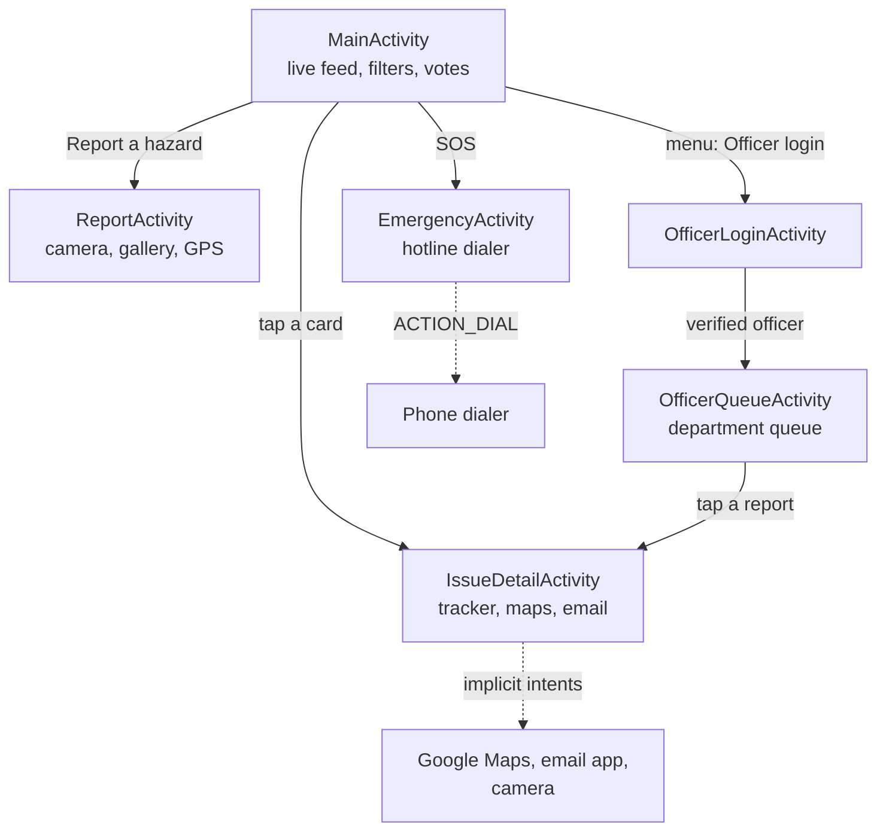
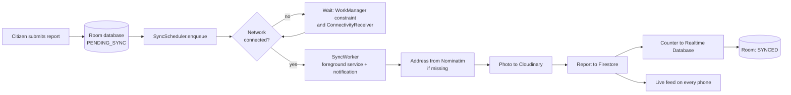

# CivicFix

**Offline-first community hazard reporting and municipal resolution platform for Android (Java).**

Citizens photograph a public hazard (pothole, dead streetlight, open manhole, water leak, overflowing bin). The app tags the report with GPS and a street address, and saves it on the phone even with no internet. When the connection returns, reports upload automatically in the background. Neighbours upvote the hazards that matter, and municipal officers resolve them with photographic proof that citizens can see.

- **Course:** Advanced Programming Laboratory
- **Author:** AFRA YASMIN
- **Platform:** Android 8.0+ (min SDK 26), target SDK 34, Java

---

## Contents

1. [Purpose](#1-purpose)
2. [Feature guide: what each feature is for and where the code is](#2-feature-guide)
3. [Course requirements map](#3-course-requirements-map)
4. [Architecture](#4-architecture)
5. [Data model](#5-data-model)
6. [Permissions](#6-permissions)
7. [Security rules](#7-security-rules)
8. [Project structure](#8-project-structure)
9. [Tech stack and libraries](#9-tech-stack-and-libraries)
10. [Setup and run](#10-setup-and-run)
11. [Using the app](#11-using-the-app)
12. [Troubleshooting](#12-troubleshooting)
13. [Limitations and future work](#13-limitations-and-future-work)
14. [Credits](#15-credits)

> **How to read the code locations.** Java paths are relative to `app/src/main/java/com/example/civicfix/` and layouts are in `app/src/main/res/layout/`. Locations are given as `File → method`, so you can find them with **Ctrl + Shift + F** (Find in Files) in Android Studio.

---

## 1. Purpose

Broken roads, dead streetlights and open drains are reported slowly, and mobile internet is often weak exactly where the problems are. CivicFix solves three problems:

1. **Reporting should work anywhere.** Reports are stored locally first and synced later, so no report is lost to a bad connection.
2. **Priority should come from the community.** Upvotes push serious hazards to the top.
3. **Resolution should be visible.** A three-stage status tracker and a before and after photo hold the authorities accountable.

The app has two sides: a public side for citizens, and an officer side for municipal staff.

---

## 2. Feature guide

### 2.1 Citizen features

| Feature | What it is used for | Where in the code |
|---|---|---|
| **Report form** | Collects department, urgency, landmark, description, photo and location in one screen | `ui/ReportActivity.java → onCreate(), submitReport()`; layout `activity_report.xml` |
| **Camera capture** | Takes photographic proof of the hazard. The photo is written to the app's private storage | `ui/ReportActivity.java → onTakePhotoClicked(), launchCamera()`; photo path from `res/xml/file_paths.xml` and the `<provider>` in `AndroidManifest.xml` |
| **Gallery picker** | Lets the citizen attach an existing photo. Reads the file name and size from the system media provider, then copies the image | `ui/ReportActivity.java → importFromGallery()` (uses `ContentResolver`) |
| **Automatic GPS tagging** | Records the exact latitude and longitude of the hazard, no typing needed | `ui/ReportActivity.java → fetchLocation()` (Fused Location Provider) |
| **Reverse geocoding** | Turns coordinates into a readable street address through a REST API | `network/GeocodingClient.java → reverse()`, called from `ui/ReportActivity.java → lookupAddress()` |
| **Offline queue** | Saves every report on the phone as `PENDING_SYNC` so nothing is lost without internet | `db/AppDatabase.java`, `db/ReportDao.java`, `model/Report.java`; insert in `ui/ReportActivity.java → submitReport()` |
| **Background sync** | Uploads queued reports when the internet returns, even if the app is closed | `sync/SyncScheduler.java → enqueue()`, `sync/SyncWorker.java → doWork()` |
| **Photo and report upload** | Compresses the photo, uploads it to Cloudinary, then writes the report to Firestore | `sync/CloudUploader.java → upload(), compressPhoto(), uploadToCloudinary()` |
| **Upload notification** | Shows live progress ("Uploading report 2 of 3") and a "reports uploaded" message in the notification tray | `util/NotificationHelper.java`; started from `sync/SyncWorker.java → showProgress()` |
| **Offline, airplane mode and low-battery banners** | Tells the citizen why uploads are waiting, using system broadcast events | `network/ConnectivityReceiver.java → onReceive()`; shown by `MainActivity.java → updateBanner()` |
| **"Waiting to upload" bar** | Shows how many reports are still queued on this phone | `MainActivity.java → onCreate()` (observes `ReportDao.getPendingCountLive()`) |
| **Live community feed** | Shows every report on every phone in real time, as cards with photo, department, status, address and time | `MainActivity.java → startFeedListener()`, `adapter/ReportAdapter.java`, layout `item_report.xml` |
| **Department and status filters** | Narrows the feed by department and by lifecycle status. The two filters combine | `MainActivity.java → setupChips(), applyFilter()`; style `res/drawable/bg_chip.xml` |
| **Upvoting ("I noticed this too")** | Lets neighbours confirm a hazard. One vote per person, tap again to remove it | `MainActivity.java → toggleVote()` (Firestore transaction), `adapter/ReportAdapter.java → bind()` |
| **Anonymous identity** | Gives each phone a stable id for one-vote-per-person, with no sign-up screen | `MainActivity.java → ensureSignedIn()`; also `sync/CloudUploader.java → upload()` |
| **Priority escalation** | Reports with 5 or more votes turn 🔴 High Urgency and move to the top | `model/FeedItem.java → HIGH_URGENCY_VOTES, isHighUrgency(), PRIORITY_ORDER` |
| **Live community counter** | Shows "N reported · N resolved" using the Realtime Database | `MainActivity.java → startStatsListener()`; incremented in `sync/CloudUploader.java → upload()` and `ui/IssueDetailActivity.java → uploadProofAndResolve()` |
| **Issue detail screen** | Shows the full photo, description, address, time and votes of one report, updating live | `ui/IssueDetailActivity.java → onStart(), bind()`; layout `activity_issue_detail.xml` |
| **Status tracker (custom view)** | Three-stage progress: 🟡 Submitted, 🔵 Under Inspection, 🟢 Resolved | `view/StatusTrackerView.java → setStep(), onMeasure(), onDraw()` (a class that extends `View` and draws itself with `Canvas`); used in `ui/IssueDetailActivity.java → bind()` |
| **Before and after photos** | Shows the repair proof beside the original photo once a report is resolved | `ui/IssueDetailActivity.java → bind()` (view `proofSection`) |
| **Activity log (audit trail)** | Lists every status change with time and officer email | `ui/IssueDetailActivity.java → historyEntry(), bind()` |
| **Navigation to the hazard** | Opens Google Maps with turn-by-turn directions to the report location | `ui/IssueDetailActivity.java → navigate()` (implicit intent) |
| **One-tap grievance email** | Opens the email app with a ready-made complaint addressed to the council, with GPS, map link and photo attached | `util/GrievanceMailer.java → send(), launchEmail()`; address in `util/CivicConfig.java` |
| **Emergency hotlines (SOS)** | One-touch dialer for fire, electricity, water and municipal helpline numbers | `ui/EmergencyActivity.java → dial()`; numbers in `util/CivicConfig.java → HOTLINES`; menu item in `MainActivity.java → onCreateOptionsMenu()` |

### 2.2 Officer features

| Feature | What it is used for | Where in the code |
|---|---|---|
| **Officer login** | Email and password sign-in. The account must also have an `officers` profile in Firestore, otherwise it is rejected | `ui/OfficerLoginActivity.java → login(), verifyAndOpen()`; layout `activity_officer_login.xml` |
| **Department queue** | Shows only the officer's own department, sorted by urgency, then severity, then votes, then oldest first | `ui/OfficerQueueActivity.java → startListener(), QUEUE_ORDER`; layout `activity_officer_queue.xml` |
| **Open, Resolved and All views** | Switches between work still to do, finished work, or everything | `ui/OfficerQueueActivity.java → applyFilter()` (radio group `rgView`) |
| **Mark Under Inspection** | Tells the public that a crew has been dispatched | `ui/IssueDetailActivity.java → updateStatus()` |
| **Mark Resolved with proof photo** | Requires a proof photo of the repair (taken with the camera or chosen from the gallery), uploads it, and closes the report | `ui/IssueDetailActivity.java → startResolve(), launchProofCamera(), importProofFromGallery(), uploadProofAndResolve()` |
| **Role check on the detail screen** | Shows the officer buttons only to an officer of the matching department | `ui/IssueDetailActivity.java → loadOfficerRole(), refreshOfficerUi()` |

### 2.3 Platform features

| Feature | What it is used for | Where in the code |
|---|---|---|
| **Firestore security rules** | Citizens can only create reports and vote with their own id. Officers can only change status fields of their own department. Nobody can delete reports | `firestore.rules` (published in the Firebase console) |
| **Idempotent uploads** | A retry after a partial failure overwrites the same document instead of creating a duplicate | `sync/CloudUploader.java → upload()` (document id derived from the report content) |
| **Photo compression** | Shrinks multi-megabyte camera photos before upload and fixes their rotation | `sync/CloudUploader.java → compressPhoto()` |
| **Portrait lock on the report form** | Stops the form from losing the photo and GPS fix when the phone rotates | `AndroidManifest.xml` (`ReportActivity`, `screenOrientation="portrait"`) |

---

## 3. Course requirements map

This table maps the demonstration points from the final project guidelines to the code.

| Requirement | How CivicFix meets it | Where in the code |
|---|---|---|
| **Multi-Activity navigation** | Six screens: feed, report form, detail, officer login, officer queue, emergency | `AndroidManifest.xml`; navigation in `MainActivity.java` and `ui/*Activity.java` |
| **Explicit intents** | Opening our own screens, passing the report id as an extra | `MainActivity.java → setOnOpenListener(...)`, `ui/OfficerQueueActivity.java → onCreate()`, `ui/OfficerLoginActivity.java → verifyAndOpen()` |
| **Implicit intents** | Maps navigation, email with attachment, phone dialer, gallery picker, camera | `ui/IssueDetailActivity.java → navigate()`, `util/GrievanceMailer.java → launchEmail()`, `ui/EmergencyActivity.java → dial()`, `ui/ReportActivity.java → galleryLauncher / takePictureLauncher` |
| **View Binding** | Enabled in Gradle and used by every screen and by the adapter | `app/build.gradle` (`buildFeatures { viewBinding true }`); `ActivityMainBinding`, `ActivityReportBinding`, `ItemReportBinding` and others |
| **Event handling** | Click listeners, radio group listener, chip selection, LiveData observers, Firestore snapshot listeners | `MainActivity.java → setupChips()`, `ui/OfficerQueueActivity.java → rgView.setOnCheckedChangeListener`, `ui/ReportActivity.java → onCreate()` |
| **Layouts** | LinearLayout, FrameLayout, ScrollView, HorizontalScrollView and CardView layouts | `res/layout/*.xml` |
| **RecyclerView, Adapter, ViewHolder** | Feed and officer queue use one `ListAdapter` with a `ViewHolder` and `DiffUtil` for smooth live updates | `adapter/ReportAdapter.java` (`ReportAdapter`, `VH`, `DIFF`); layout `item_report.xml` |
| **Custom Views** | `StatusTrackerView` extends `View`, measures itself, draws circles, connectors, check marks and labels on a `Canvas`, animates between steps with a `ValueAnimator`, and sets a content description for screen readers | `view/StatusTrackerView.java` (`onMeasure()`, `onSizeChanged()`, `onDraw()`, `setStep()`); used in `activity_issue_detail.xml` as `<com.example.civicfix.view.StatusTrackerView>` |
| **Broadcast receivers (system events)** | Reacts to connectivity changes, airplane mode, low battery and battery okay | `network/ConnectivityReceiver.java`; registered in `CivicFixApp.java → onCreate()`; UI in `MainActivity.java → updateBanner()` |
| **Content providers** | Reads shared device media through `ContentResolver` (gallery). Shares private photos with the camera and email apps through `FileProvider` | `ui/ReportActivity.java → importFromGallery()`, `ui/IssueDetailActivity.java → importProofFromGallery()`; `AndroidManifest.xml` `<provider>`; `res/xml/file_paths.xml`; `util/GrievanceMailer.java` |
| **Services and notifications** | Background sync runs as a WorkManager foreground service (`SystemForegroundService`, type `dataSync`) with a live progress notification | `sync/SyncWorker.java → showProgress()`; `util/NotificationHelper.java`; service declared in `AndroidManifest.xml` |
| **Background tasks** | WorkManager job with a "network connected" constraint and exponential backoff | `sync/SyncScheduler.java → enqueue()`, `sync/SyncWorker.java → doWork()` |
| **Runtime permissions** | Camera, location and notifications are requested when needed, with a clear message if denied | `ui/ReportActivity.java → onTakePhotoClicked(), fetchLocation()`; `MainActivity.java → onCreate()`; `ui/IssueDetailActivity.java → startResolve()` |
| **Networking: HTTP and JSON** | GET request to Nominatim with JSON parsing, and a multipart POST to Cloudinary with JSON parsing of the response | `network/GeocodingClient.java → reverse()`; `sync/CloudUploader.java → uploadToCloudinary()` |
| **Firebase Authentication** | Anonymous sign-in for citizens and email/password for officers | `MainActivity.java → ensureSignedIn()`; `ui/OfficerLoginActivity.java → login()` |
| **Cloud Firestore** | Reports, votes, officer profiles, status history, live listeners and transactions | `sync/CloudUploader.java`; `MainActivity.java → startFeedListener(), toggleVote()`; `ui/IssueDetailActivity.java`; `ui/OfficerQueueActivity.java` |
| **Firebase Realtime Database** | A live community counter (`stats/total`, `stats/resolved`) | `MainActivity.java → startStatsListener()`; `sync/CloudUploader.java → upload()`; `ui/IssueDetailActivity.java → uploadProofAndResolve()` |
| **Picture storage** | Photos are stored on Cloudinary (Firebase Storage needed a paid plan). Each report keeps the photo URL. A local copy stays in the app's private storage until synced | `sync/CloudUploader.java`; local files in `ui/ReportActivity.java → photosDir()` |
| **Local database** | Room (SQLite) holds the offline queue | `db/AppDatabase.java`, `db/ReportDao.java`, `model/Report.java` |
| **Layout responsiveness** | Weight-based layouts, `match_parent` and scrolling containers. All screens except the report form rotate freely | `res/layout/*.xml`; `AndroidManifest.xml` |

---

## 4. Architecture

### 4.1 Screens and navigation



### 4.2 Offline sync flow



### 4.3 Layers

| Layer | Classes |
|---|---|
| **UI** | `MainActivity`, `ui/*Activity`, `adapter/ReportAdapter` and the layouts |
| **Local data** | `db/AppDatabase`, `db/ReportDao`, `model/Report` |
| **Cloud data** | Firebase (Firestore, Auth, Realtime Database) and Cloudinary, reached through `sync/CloudUploader` and the listeners in the activities |
| **Background work** | `sync/SyncWorker`, `sync/SyncScheduler`, `network/ConnectivityReceiver`, `CivicFixApp` |
| **Helpers** | `util/NetworkUtil`, `util/NotificationHelper`, `util/GrievanceMailer`, `util/CivicConfig`, `network/GeocodingClient` |

---

## 5. Data model

### 5.1 Room table `reports` (on the phone)

| Column | Meaning |
|---|---|
| `id` | Local auto-increment key |
| `cloudId` | Firestore document id, set after sync |
| `category`, `severity`, `description`, `landmark` | What the citizen entered |
| `latitude`, `longitude`, `address` | Location (the address can be filled in later by the sync worker) |
| `localPhotoPath`, `photoUrl` | Photo file on the phone, and its Cloudinary URL after sync |
| `syncState` | `PENDING_SYNC` or `SYNCED` |
| `createdAt` | Time of submission (milliseconds) |

### 5.2 Firestore

**`reports/{id}`**

| Field | Written by | Meaning |
|---|---|---|
| `category`, `severity`, `description`, `landmark`, `latitude`, `longitude`, `address`, `photoUrl`, `createdAt` | Sync worker | Report content |
| `status` | Sync worker, then officers | `Submitted`, `Under Inspection` or `Resolved` |
| `upvotes`, `voters[]` | Citizens (transaction) | Vote count and the anonymous ids that voted |
| `afterPhotoUrl`, `resolvedAt` | Officer | Proof of the repair |
| `statusHistory[]` | Officer | Entries `{status, at, by}` for the activity log |

**`officers/{uid}`**: `department` (must match a report category exactly) and `name`. These are created by hand in the Firebase console.

### 5.3 Realtime Database

```
stats
  total     number of reports ever uploaded
  resolved  number of reports resolved
```

---

## 6. Permissions

| Permission | Why | Requested in |
|---|---|---|
| `CAMERA` | Photo of the hazard and the proof of repair | `ui/ReportActivity.java`, `ui/IssueDetailActivity.java` |
| `ACCESS_FINE_LOCATION`, `ACCESS_COARSE_LOCATION` | GPS tagging | `ui/ReportActivity.java → fetchLocation()` |
| `POST_NOTIFICATIONS` | Upload progress and completion notifications (Android 13+) | `MainActivity.java → onCreate()` |
| `INTERNET`, `ACCESS_NETWORK_STATE` | Cloud sync, geocoding, connectivity checks | Manifest (normal permissions) |
| `FOREGROUND_SERVICE`, `FOREGROUND_SERVICE_DATA_SYNC` | Foreground upload service | Manifest (normal permissions) |

The phone dialer uses `ACTION_DIAL`, which needs no permission, because the user presses call themselves.

---

## 7. Security rules

- **Firestore rules** are in `firestore.rules` at the project root. In short:
    - Anyone can read reports.
    - A signed-in user (anonymous or officer) can create a valid new report only: known department, status `Submitted`, zero votes.
    - A citizen can change only `voters` and `upvotes`, and only by adding or removing their own id.
    - An officer can change only `status`, `afterPhotoUrl`, `resolvedAt` and `statusHistory`, and only on reports of their own department.
    - Nobody can delete reports. Officer profiles are readable only by their owner.
- **Realtime Database rules** (publish in the console):

```json
{
  "rules": {
    "stats": {
      ".read": true,
      "total":    { ".write": "auth != null", ".validate": "newData.isNumber() && newData.val() >= 0" },
      "resolved": { ".write": "auth != null", ".validate": "newData.isNumber() && newData.val() >= 0" }
    }
  }
}
```

---

## 8. Project structure

```
CivicFix/
├── README.md
├── firestore.rules
├── app/
│   ├── build.gradle
│   ├── google-services.json
│   └── src/main/
│       ├── AndroidManifest.xml
│       ├── java/com/example/civicfix/
│       │   ├── CivicFixApp.java            registers receivers, creates channels, starts sync
│       │   ├── MainActivity.java           feed, filters, voting, stats, banners
│       │   ├── adapter/
│       │   │   └── ReportAdapter.java      RecyclerView adapter and ViewHolder
│       │   ├── db/
│       │   │   ├── AppDatabase.java        Room database
│       │   │   └── ReportDao.java          queries for the offline queue
│       │   ├── model/
│       │   │   ├── Report.java             local (Room) entity
│       │   │   └── FeedItem.java           cloud model, urgency and sort rules
│       │   ├── network/
│       │   │   ├── ConnectivityReceiver.java   system broadcasts
│       │   │   └── GeocodingClient.java        reverse geocoding (HTTP + JSON)
│       │   ├── sync/
│       │   │   ├── SyncScheduler.java      queues the background job
│       │   │   ├── SyncWorker.java         foreground-service worker
│       │   │   └── CloudUploader.java      Cloudinary + Firestore + Realtime DB
│       │   ├── ui/
│       │   │   ├── ReportActivity.java
│       │   │   ├── IssueDetailActivity.java
│       │   │   ├── OfficerLoginActivity.java
│       │   │   ├── OfficerQueueActivity.java
│       │   │   └── EmergencyActivity.java
│       │   ├── view/
│       │   │   └── StatusTrackerView.java  custom View drawn with Canvas
│       │   └── util/
│       │       ├── CivicConfig.java        council email, hotline numbers
│       │       ├── GrievanceMailer.java    email intent with attachment
│       │       ├── NetworkUtil.java        online check
│       │       └── NotificationHelper.java notification channels and builders
│       └── res/
│           ├── layout/                     one layout per screen, plus item_report.xml
│           ├── drawable/                   bg_badge.xml, bg_chip.xml
│           └── xml/file_paths.xml          FileProvider folders
```

---

## 9. Tech stack and libraries

| Area | Technology |
|---|---|
| Language and platform | Java, Android Studio, min SDK 26, target SDK 34 |
| UI | AppCompat, ConstraintLayout, RecyclerView, CardView, View Binding, Glide (image loading) |
| Local database | Room 2.5.2 (SQLite) |
| Background work | WorkManager 2.9.0, `BroadcastReceiver`, foreground service |
| Location | Google Play Services Location (Fused Location Provider) |
| Firebase | Cloud Firestore, Authentication, Realtime Database (BoM 32.7.0) |
| Photo hosting | Cloudinary free tier with an unsigned upload preset |
| Geocoding | OpenStreetMap Nominatim REST API |

---

## 10. Setup and run

1. **Clone** the repository and open it in Android Studio. Let Gradle sync finish.
2. **Firebase project.** Create one at console.firebase.google.com and add an Android app with the package name `com.example.civicfix`.
3. **Config file.** Download `google-services.json` **after** creating the databases (step 4), and put it in the `app/` folder. If it was downloaded earlier, download it again.
4. **Enable these services:**
    - **Firestore Database**: create it, then paste `firestore.rules` into the **Rules** tab and publish.
    - **Realtime Database**: create it, paste the rules from section 7, and import `{"stats": {"total": 0, "resolved": 0}}` into the **Data** tab.
    - **Authentication > Sign-in method**: enable **Anonymous** and **Email/Password**.
5. **Create an officer.**
    - **Authentication > Users > Add user** (email and password).
    - **Firestore**: add a document to a collection `officers`, using the user's UID as the Document ID, with the string fields `department` (one of `Roads & Transport`, `Power & Electricity`, `Water & Sewage`, `Sanitation & Waste`) and `name`.
6. **Cloudinary.** Create a free account and an **unsigned** upload preset (Settings > Upload > Upload presets). Put the cloud name and preset name into the two constants at the top of `sync/CloudUploader.java`. Never put the API key or API secret in the app.
7. **Local settings.** Edit `util/CivicConfig.java`: the council email address and the hotline numbers. The defaults are Bangladesh numbers (national emergency 999, fire service 102, the national power hotline 16999, Khulna WASA's call centre, and the national helpline 333). Check them for your own city before relying on them. Numbers that start with `REPLACE` show "not set yet".
8. **Run** on a real phone with the green **Run** button.

---

## 11. Using the app

**As a citizen**
1. Tap **Report a hazard**, allow location and camera, and take or choose a photo. The location line shows the coordinates, then the street address when online.
2. Choose the department and urgency, describe the hazard, and tap **Submit report**.
3. With no internet, the report appears under the orange "waiting to upload" bar. When the connection returns, a notification shows the upload progress.
4. In the feed, filter by department and status, tap **I noticed this too** to vote, and tap a card to see the details, navigate to the site, or email the council.
5. The **🚨 SOS** button in the top bar opens the emergency hotline dialer.

**As an officer**
1. Open **⋮ > Officer login** and sign in.
2. The queue shows your department's reports, most urgent first. Use **Open / Resolved / All** to switch views.
3. Open a report and tap **Mark as Under Inspection**, then **Mark as Resolved** (a proof photo is required). Citizens see the tracker update live, with before and after photos.

---

## 12. Troubleshooting

| Problem | Cause and fix |
|---|---|
| App crashes at launch with `Writable dex file ... is not allowed` | Android Studio's quick-patch install is rejected by Android 14+. Uninstall the app, tick **Run > Edit Configurations > Always install with package manager**, and press the plain green **Run** button. Avoid the Apply Changes buttons |
| `INSTALL_FAILED_USER_RESTRICTED` on a Xiaomi phone | Turn on **Install via USB** in Developer options |
| Report stays in the queue and never uploads | Check Logcat (filter `tag:CivicFix`) for `Sync failed`. Usual causes: wrong Cloudinary cloud name or preset, or Firestore rules rejecting the data |
| Feed shows an error toast with `PERMISSION_DENIED` | The Firestore rules are missing or too strict. Republish `firestore.rules` |
| Green counter bar never appears | `google-services.json` was downloaded before the Realtime Database existed. Download it again and rebuild |
| Officer login says "not registered as a municipal officer" | The `officers` document is missing, its Document ID is not the exact UID, or it has no `department` field |
| Officer queue is empty | The officer's `department` text does not match the reports' `category` exactly |
| No upload notification | Allow notifications for the app. On Xiaomi, also set **Battery saver > No restrictions** and enable **Autostart** |
| Sync waits until the app is reopened | Swiping the app away force-stops it on some phones, which cancels scheduled work until the next launch. Press Home instead of swiping the app away |

---

## 13. Limitations and future work

- Anonymous accounts are free to create, so a production app should add **Firebase App Check** and rate limiting.
- Photos and text are not moderated.
- Voting needs an internet connection.
- The report form uses the phone's camera app. An embedded **CameraX** preview could replace it.
- Official hotline numbers and the council email must be filled in for each city.
- Officer accounts are created by hand. A real deployment would need an admin tool.
- Nominatim is free for light use only (about one request per second), so a high-traffic app would need its own geocoding service.

---

## 14. Credits

- Address lookup: © OpenStreetMap contributors, through the Nominatim API
- Photo hosting: Cloudinary
- Backend: Google Firebase
- Image loading: Glide